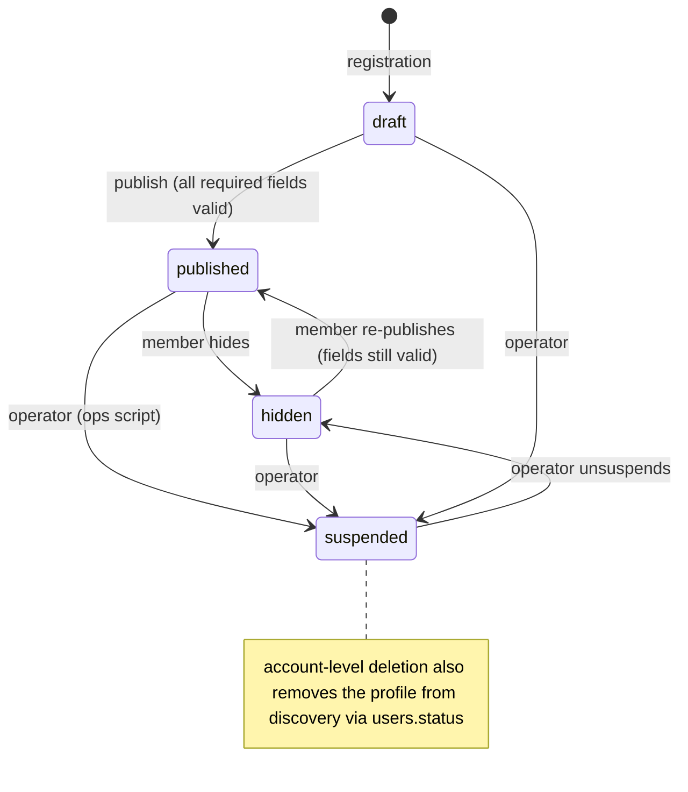
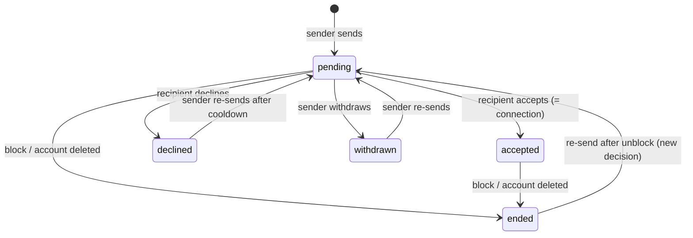

# 03 — Software Requirements Specification (SRS)

| Field | Value |
|---|---|
| Product | DUJON (দুজন) |
| Version | 1.0 (draft) |
| Date | 20 November 2026 |
| Status | Awaiting owner approval |

This document specifies *how the system behaves* for every functional requirement in `02-prd-product-requirements.md`. IDs are identical. Where this document and another disagree, raise it in `13-open-decisions-and-assumptions.md`; do not guess.

---

## 1. System overview

A single Next.js (App Router, TypeScript) application provides public pages, authenticated member pages and a versioned REST API (`/api/v1`). All business rules live in a server-side **service layer** (`src/server/services/*`) used by both page rendering/Server Actions and API route handlers. Data is stored in MySQL 8; photos in a private S3-compatible bucket. See `06-technical-architecture.md`.

## 2. Configuration (single source: `src/config/app.ts`, overridable by environment)

| Key | Default | Used by |
|---|---|---|
| `MIN_REGISTRATION_AGE` | 18 | FR-AUTH-002 |
| `MAX_REGISTRATION_AGE` | 100 | FR-AUTH-001 (sanity bound) |
| `SEARCH_AGE_MIN_BOUND` / `SEARCH_AGE_MAX_BOUND` | 18 / 70 | FR-DISC-003, FR-PREF |
| `SEARCH_PAGE_SIZE` | 20 | FR-DISC-008 |
| `SEARCH_MAX_PAGE` | 50 | FR-DISC-008 (prevents deep scraping) |
| `REQUIRE_PUBLISHED_PROFILE_TO_SEARCH` | true | FR-DISC-001 |
| `REQUIRE_VERIFIED_EMAIL_FOR_INTERESTS` | true | FR-AUTH-010, FR-INT-002 |
| `INTEREST_DAILY_LIMIT` | 20 | FR-INT-007 |
| `INTEREST_DECLINE_COOLDOWN_DAYS` | 30 | FR-INT-006 |
| `SESSION_TTL_DAYS` | 30 | FR-AUTH-008 |
| `PASSWORD_RESET_TTL_MINUTES` | 60 | FR-AUTH-009 |
| `EMAIL_VERIFY_TTL_HOURS` | 24 | FR-AUTH-010 |
| `ACCOUNT_PURGE_AFTER_DAYS` | 30 | FR-ACC-005 |
| `PHOTO_MAX_BYTES` | 5,242,880 | FR-PHOTO-001 |
| `PHOTO_MIN_DIMENSION` | 400 | FR-PHOTO-001 |
| `APP_TIMEZONE` | Asia/Dhaka | all date rules |
| `TERMS_VERSION` / `PRIVACY_VERSION` | `2026-11-v1` | FR-AUTH-005 |

## 3. Roles and permission matrix

States: **G** guest · **U** member with draft/hidden profile · **P** member with published profile · **S** suspended/deactivated (cannot log in).

| Capability | G | U | P | S |
|---|---|---|---|---|
| View public pages, switch language, contact form | ✓ | ✓ | ✓ | ✓ (as guest) |
| Register / login | ✓ | – | – | ✗ (login refused, generic error) |
| Edit own profile, preferences, photo, settings | ✗ | ✓ | ✓ | ✗ |
| Search / view other profiles | ✗ | ✗ (prompt) | ✓ | ✗ |
| Send interest | ✗ | ✗ | ✓ (+ verified email) | ✗ |
| Accept/decline received interest | ✗ | ✓* | ✓ (+ verified email) | ✗ |
| View existing connections & contacts | ✗ | ✓ | ✓ | ✗ |
| Save profile | ✗ | ✗ | ✓ | ✗ |
| Block / report | ✗ | ✓ (from interests list) | ✓ | ✗ |
| Delete account | ✗ | ✓ | ✓ | ✗ (via support) |

\* A hidden-profile member can still respond to interests received before hiding (they chose to be visible then). A draft-profile member cannot have received any.

Authorisation is checked in the service layer on every call, never only in the UI.

## 4. Module specifications

### 4.1 AUTH — Registration, login, sessions

**Inputs (registration):**

| Field | Type | Rules |
|---|---|---|
| `fullName` | string | Trimmed; 2–80 chars; Bangla or Latin letters, spaces, `.`, `-`, `'`; collapse repeated spaces. Private (never shown to others). |
| `email` | string | ≤ 254 chars; valid format; normalised to lower case; stored unique. |
| `mobile` | string, optional | Accepts `01XXXXXXXXX`, `+8801XXXXXXXXX`, `8801XXXXXXXXX`, with Bangla or Latin digits; operator prefix `01[3-9]`; stored as E.164 `+8801XXXXXXXXX`. Not unique (a parent may manage several profiles). |
| `password` | string | 8–128 chars; not in bundled common-password list (top 10k); not equal to email; no composition rules. |
| `gender` | enum | `male` \| `female`. |
| `dateOfBirth` | date `YYYY-MM-DD` | Valid calendar date; age (see §4.1.1) between 18 and 100 inclusive. |
| `acceptTerms` | boolean | Must be `true`; covers Terms, Privacy Policy, and "I am 18 or older". |
| `locale` | `bn` \| `en` | From current UI locale. |
| `website` | string | Honeypot; must be empty (bots fill it). |

**4.1.1 Age calculation.** `age = full years between dateOfBirth and today`, where *today* is the current date in `Asia/Dhaka`. Birthdays on 29 February are treated as 1 March in non-leap years (conservative for the 18+ rule). Implemented once in `src/server/lib/age.ts`; used by registration, display and search.

**Processing (register):**
1. Validate with the shared Zod schema (same schema used in the browser).
2. Rate-limit check (§5).
3. If email already exists → send "someone tried to register with your email" email to the existing address, return the same success response as a new registration, do **not** create a session. (FR-AUTH-003)
4. Hash password with Argon2id. Create `users` row (`status=active`, `role=user`, versions + `terms_accepted_at`), create `profiles` row (`status=draft`, `display_name` = first word of full name, gender, DOB), create default `partner_preferences` (FR-PREF-002), create session, send verification email.
5. Redirect to `/onboarding` (FR-AUTH-013).

**Login:** email + password → generic error `INVALID_CREDENTIALS` for unknown email, wrong password, suspended, deactivated or deletion-pending accounts. Constant-time comparison; for unknown email, still run a dummy Argon2 verify to equalise timing. On success: create session, update `last_login_at`, apply `preferred_locale`, redirect to `next` (same-origin path only) or `/dashboard`.

**Sessions:** 32-byte random token (base64url) in cookie `dujon_session` (`HttpOnly; Secure; SameSite=Lax; Path=/`); database stores SHA-256 of token. Session valid while `expires_at > now`; if less than half TTL remains on use, extend to full TTL (sliding). Password change/reset deletes all sessions of the user (except the current one on change).

**Password reset:** request always returns the same message. If the email exists and account is active, create `auth_tokens` (`type=password_reset`, SHA-256 hash stored, 60 min), email link `/reset-password?token=…`. Using the token: valid, unused, unexpired → set new password, mark token used, delete all sessions, create new session.

**Email verification:** token type `email_verify`, 24 h. Visiting link sets `users.email_verified_at`. Resend allowed max 3 per hour. Banner shown on dashboard/search until verified.

**Error states:** inline field errors; form-level summary; `429` page/message for rate limits; expired-link page with "send a new link" action.

**Edge cases:**
- DOB in the future, or invalid date (e.g. 31 Feb) → `INVALID_DATE`.
- User turns 18 tomorrow → rejected today; message states they can register from their 18th birthday.
- Same email with different capitalisation → treated as same.
- Mobile entered in Bangla digits `০১৭১২৩৪৫৬৭৮` → normalised and accepted.
- `next=//evil.com` or absolute URL → ignored, default redirect used.

### 4.2 PROF — Profile

**Fields (shared profile model):**

| Field | Required to publish | Type / rule | Shown to others |
|---|---|---|---|
| `displayName` | ✓ | 2–40 letters/spaces; no digits, `@`, URLs; default = first word of full name | ✓ |
| `gender` | ✓ (from registration) | read-only | used for discovery; shown implicitly |
| `dateOfBirth` | ✓ (from registration) | read-only | **age only** |
| `createdBy` | – (default `self`) | `self` \| `parent` \| `guardian` \| `sibling` \| `relative` | badge if not `self` |
| `maritalStatus` | ✓ | `never_married` \| `divorced` \| `widowed` | ✓ |
| `heightCm` | – | integer 120–220; UI entry in feet/inches (4′0″–7′2″), display in ft/in | ✓ |
| `educationLevel` | ✓ | `below_ssc` \| `ssc` \| `hsc` \| `diploma` \| `bachelors` \| `masters` \| `doctorate` \| `other` | ✓ |
| `educationDetail` | – | ≤ 100 chars, e.g. "BSc in CSE" | ✓ |
| `occupation` | ✓ | 2–100 chars free text | ✓ |
| `divisionId`, `districtId`, `upazilaId` | ✓ | valid hierarchy (FR-LOC-003) | district + division on card; all three on detail |
| `about` | ✓ | 30–1,000 chars | ✓ |
| `familyInfo` | – | ≤ 500 chars, guidance: "Brief, e.g. number of siblings, parents' occupation. Do not include addresses or phone numbers." | ✓ |
| `photoVisibility` | – | `members` (default) \| `connections` | controls photo |

**Free-text rules (FR-PROF-008):** for `displayName`, `occupation`, `educationDetail`, `about`, `familyInfo`:
- Trim, collapse whitespace, remove control characters and zero-width characters, normalise Unicode (NFC).
- Convert Bangla digits to Latin *for detection only*.
- Reject if it contains: 10+ digit sequences (after removing spaces/dashes), Bangladeshi mobile patterns, email patterns, URLs/domains (`http`, `www.`, `.com`, `.bd` etc.), or social handles pattern `@\w{3,}`. Error code `CONTACT_INFO_NOT_ALLOWED`.
- Store as plain text; render escaped (React default). No HTML or Markdown.

**Onboarding (FR-PROF-001):** Steps and what each saves:

| Step | Route | Fields |
|---|---|---|
| 1 About you | `/onboarding/about` | displayName, createdBy, maritalStatus, heightCm, educationLevel, educationDetail, occupation, about, familyInfo |
| 2 Location | `/onboarding/location` | divisionId, districtId, upazilaId |
| 3 Photo (optional, skippable) | `/onboarding/photo` | photo + photoVisibility |
| 4 Preferences & publish | `/onboarding/preferences` | partner preferences; review summary; Publish button |

`profiles.onboarding_step` records the furthest completed step; `/onboarding` redirects to the next incomplete step. Members can leave onboarding at any time; dashboard shows the checklist.

**Status state machine:**

Unsuspending returns the profile to `hidden` so the member consciously re-publishes.

**Edge cases:** editing a published profile so a required field becomes empty is rejected (`PROFILE_INCOMPLETE`) — the member must hide first if they want to clear it. Changing location of a published profile is allowed.

### 4.3 PREF — Partner preferences

- `ageMin`, `ageMax`: integers within bounds; `ageMin ≤ ageMax`.
- Optional `divisionId`, `districtId`, `upazilaId` with hierarchy validation; child requires parent.
- Default on registration: `[max(18, age−5), min(70, age+5)]`.
- Preferences never affect who can see *you*; they only pre-fill your own search (FR-PREF-003). (Hiding yourself from people outside your preferences is **[FUTURE]**.)

### 4.4 LOC — Locations

- Tables `divisions`, `districts`, `upazilas` (the latter includes city-corporation thanas with `type='thana'`). See doc 07 §4.
- Source file: `data/locations/bd-locations.v1.json` with a manifest (counts, source, retrieved date, licence). Seed script is idempotent (upsert by stable code).
- UI label: "উপজেলা / থানা" / "Upazila / Thana".
- Cascading behaviour (FR-LOC-002): selecting division loads districts (cached API, see API-009–011); selecting a different division clears district + upazila; selecting a different district clears upazila; options sorted by locale name.
- Location lists are cacheable for 24 h (public, non-personal data).

### 4.5 DISC — Discovery and search

**Inputs (query parameters, all optional):**

| Param | Type | Rule |
|---|---|---|
| `age_min`, `age_max` | int | within bounds; if both present `age_min ≤ age_max` |
| `division`, `district`, `upazila` | int IDs | hierarchy-consistent; a child without its parent is accepted only if consistent — parent is inferred server-side |
| `page` | int | 1…`SEARCH_MAX_PAGE` |
| `reset` | `1` | ignore preferences, use blank filters |

**Defaults:** no filter params and no `reset` → use the viewer's partner preferences (FR-PREF-003).

**Eligibility predicate (`isDiscoverable(viewer, target)`) — single source of truth, used by search, profile detail, saved list, interest send and photo access:**

1. `viewer.user.status = active` and viewer profile `published` (if config requires).
2. `target.profile.status = published` and `target.user.status = active`.
3. `target.user_id ≠ viewer.user_id`.
4. `target.gender = targetGenderFor(viewer.gender)` where `targetGenderFor('male') = 'female'`, `targetGenderFor('female') = 'male'`.
5. No row in `blocks` where (blocker = viewer, blocked = target) or (blocker = target, blocked = viewer).
6. Target age ≥ 18 (defence in depth).

**Age → date-of-birth translation (inclusive):** for `today` in Asia/Dhaka, `age ≥ a ⇔ dob ≤ today − a years`; `age ≤ b ⇔ dob > today − (b+1) years`. Computed in application code and passed as parameters, so the database uses an index range on `date_of_birth`.

**Ordering:** `published_at DESC, id DESC`. **Pagination:** offset-based (`LIMIT 20 OFFSET (page−1)*20`) for shareable page numbers; `SEARCH_MAX_PAGE` caps depth. Cursor pagination is the documented upgrade path if volumes grow (doc 08 §5).

**Output (card):** `publicId`, `displayName`, `age`, `district`, `division`, `occupation`, `educationLevel`, `maritalStatus`, `createdBy`, `photo` (thumbnail URL or null per visibility), `isSaved`, `interestStatus` (none / sent / received / connected / not_accepted).

**Empty state:** "No profiles match these filters yet" + suggestions + Clear filters. **Error state:** invalid filters → filters panel shows inline error; results area shows message; API 400.

**Profile detail (FR-DISC-011):** `/profiles/{publicId}`. If `isDiscoverable` is false **and** the viewer is not connected to the target, respond 404 (never 403, to avoid confirming existence). Exception: members with an accepted connection can always view each other's profile while both accounts are active and neither blocked the other, even if the profile was later hidden.

### 4.6 INT — Interests and connections

**Interest statuses:** `pending`, `accepted`, `declined`, `withdrawn`, `ended` (system: block or account deletion).

**Send algorithm (FR-INT-001–003, 006, 007):**
1. Check sender permissions (published, active, verified email if configured).
2. Load target; `isDiscoverable(sender, target)` else `PROFILE_NOT_AVAILABLE` (404).
3. If any interest between the pair (either direction) is `accepted` → `ALREADY_CONNECTED`.
4. If reverse interest (target → sender) is `pending` → `REVERSE_INTEREST_PENDING` (UI shows "They already expressed interest in you — Accept?").
5. Existing row sender → target:
   - `pending` → `INTEREST_EXISTS`;
   - `declined` and `responded_at > now − cooldown` → `INTEREST_COOLDOWN` (include date allowed again);
   - otherwise reuse the row: set `pending`, `created_at = now`, clear `responded_at`.
6. Count sender interests with `created_at > now − 24h` (sent or re-sent) ≥ limit → `INTEREST_DAILY_LIMIT`.
7. Insert/update inside a transaction with a unique key on (sender, receiver) to prevent races. Notify recipient (FR-INT-009).

**Accept/decline:** only recipient; only from `pending`; recipient must be active (and email verified if configured). Accept sets `accepted`, `responded_at`; notifies sender.

**Withdraw:** only sender; only from `pending`.

**Contact reveal (FR-INT-008):** visible only when an `accepted` interest exists between the two and both accounts are active and no block exists. Shows the counterpart's account email and mobile (if any) with safety tips. Contact data is never included in search results or any API other than the connection/profile-detail responses for connected pairs.

**Edge cases:**
- Recipient hides their profile while an interest is pending → recipient can still accept or decline it; the sender's status is unchanged.
- Sender hides their profile while the interest is pending → the interest stays `pending`; in the recipient's Received list it shows "This profile is currently hidden" and Accept is disabled until the sender re-publishes (prevents connecting to someone who is not visible).

### 4.7 SAVE

Composite unique (member, saved member). Saved list query re-applies `isDiscoverable`. Max 500 saved profiles per member (soft limit, `SAVED_LIMIT`).

### 4.8 PHOTO

**Upload pipeline:** `multipart/form-data` → size check (reject > 5 MB before reading fully) → magic-byte sniff (JPEG/PNG/WebP only) → decode with `sharp` (fail = `INVALID_IMAGE`) → check min dimension 400 px → auto-rotate by orientation → resize to 800 px longest side (`full`) and 320 px square cover crop (`thumb`) → encode WebP (quality ~80) → **all metadata stripped** → upload both to private bucket with keys `photos/{random-uuid}/full.webp` and `/thumb.webp` → in one transaction mark previous photo for deletion and insert new `profile_photos` row → delete old objects (retry on failure via purge job).

**Delivery:** `GET /api/v1/photos/{photoId}/{size}` checks: viewer is the owner, or (`isDiscoverable(viewer, owner)` and `visibility=members`), or viewer is connected to owner. Then streams the object (or 302 to a 60-second presigned URL). Headers: `Cache-Control: private, max-age=300`, `X-Robots-Tag: noindex`, `Content-Disposition: inline`. Unauthorised → 404.

**Moderation limitation (documented to users):** photos are not reviewed before they appear. Members can report inappropriate photos; the operator can remove a photo with `ops:remove-photo`. `profile_photos.moderation_status` exists for a future review queue.

### 4.9 SAFE — Block, report, operator scripts

**Block:** idempotent insert into `blocks`; in the same transaction set any `pending`/`accepted` interests between the pair to `ended`; remove saved entries in both directions. Blocked member is not notified. Unblock deletes the row only.

**Report:** reasons enum `fake_profile`, `inappropriate_photo`, `harassment`, `money_request_or_scam`, `appears_underage`, `married_or_misleading`, `other`; `details` ≤ 1,000 chars (contact-info rule not applied — reporters may need to quote). One `open` report per (reporter, reported). Optional block. Email to `OPS_EMAIL` with report ID and reason only (no free-text details in email body to limit data spread; operator reads details via script).

**Operator scripts (FR-SAFE-007)** — run locally against production with a restricted DB user, documented in doc 12:

| Script | Effect |
|---|---|
| `ops:reports [--status open]` | Lists reports with reported publicId, reason, counts |
| `ops:show --user <publicId>` | Shows moderation-relevant fields (no password hash, no tokens) |
| `ops:suspend --user <publicId> --reason "<text>"` | `users.status=suspended`, `profiles.status=suspended`, delete sessions, end interests, log action |
| `ops:unsuspend --user <publicId> --reason` | `users.status=active`, `profiles.status=hidden`, log action |
| `ops:remove-photo --user <publicId> --reason` | Delete photo objects + row, log action |
| `ops:resolve-report --id <n> --outcome resolved\|dismissed --note` | Close report, log action |

Every script writes a `moderation_actions` row (`actor` = operator name from env `OPS_ACTOR`).

### 4.10 DASH

Overview data in one query bundle (no N+1): profile status, onboarding checklist booleans, `email_verified_at`, count pending received, count connections, count saved.

### 4.11 ACC

- **Password change:** current password; new password policy; revoke other sessions.
- **Language:** `bn|en`.
- **Notifications:** `notify_interest_received`, `notify_interest_accepted` booleans (default true).
- **Mobile:** add/change/remove using registration rules.
- **Email change:** via support in MVP (operator verifies ownership manually). **[ASSUMPTION OD-028]**
- **Delete account:** requires password + typing the confirmation word ("মুছে ফেলুন" in bn / "DELETE" in en). Transaction: `users.status=pending_deletion`, `deletion_requested_at=now`, profile `hidden`, all `pending`/`accepted` interests set to `ended` (`ended_reason='account_deleted'`), sessions deleted. Saved entries and blocks are left until the purge job (they have no visible effect while the account is hidden). Log out and show the confirmation page (SCR-27).
- **Purge job** (daily, Vercel Cron → `/api/internal/cron/purge`): for users with `pending_deletion` older than 30 days: delete photo objects; delete profile, preferences, photos rows, saved, blocks, interests, sessions, tokens; anonymise `users` row (email → `deleted+{id}@invalid.dujon`, name/mobile null, password hash null, status `deleted`, `deleted_at` set) to keep referential integrity for reports; reports keep `reported_user_id` but the snapshot fields are nulled except reason/outcome. Also purges expired sessions/tokens and old rate-limit rows.

### 4.12 PUB — Contact form

Fields: `name` (2–80), `email`, `mobile` (optional), `subject` (`general`, `account_help`, `safety`, `feedback`, `other`), `message` (10–2,000), honeypot. Rate limit 5/hour/IP. Stored in `contact_messages`; email to `OPS_EMAIL` with reply-to = sender. Contact messages deleted after 12 months (purge job).

## 5. Rate limits

Implemented with a MySQL-backed fixed-window counter (`rate_limits` table) — no extra service. Keys use SHA-256 of IP and/or normalised identifier.

| Action | Limit | Key |
|---|---|---|
| Register | 5 / hour | IP |
| Login failures | 10 / 15 min per email; 30 / 15 min per IP | email hash, IP |
| Forgot password | 3 / hour per email; 10 / hour per IP | email hash, IP |
| Verification resend | 3 / hour | user |
| Contact form | 5 / hour | IP |
| Interest send | `INTEREST_DAILY_LIMIT` / 24 h (business rule, from `interests` table) + 30 / min burst | user |
| Report | 10 / day | user |
| Photo upload | 10 / day | user |
| Search | 120 / min | user |

## 6. Standard error codes

| Code | HTTP | Meaning (user message in doc 05) |
|---|---|---|
| `VALIDATION_ERROR` | 400 | One or more fields invalid (`fields` map included) |
| `INVALID_DATE` | 400 | Date not valid |
| `UNDER_AGE` | 400 | Younger than 18 |
| `INVALID_AGE_RANGE` | 400 | min > max or out of bounds |
| `LOCATION_MISMATCH` | 400 | Location hierarchy inconsistent |
| `CONTACT_INFO_NOT_ALLOWED` | 400 | Phone/email/URL in free text |
| `PROFILE_INCOMPLETE` | 409 | Required fields missing (`missing` list) |
| `FIELD_NOT_EDITABLE` | 400 | Tried to change gender/DOB |
| `UNAUTHENTICATED` | 401 | Login required |
| `INVALID_CREDENTIALS` | 401 | Login failed (generic) |
| `FORBIDDEN` | 403 | Authenticated but not allowed (only for own-resource actions, never to hide existence) |
| `PROFILE_NOT_PUBLISHED` | 403 | Viewer must publish to search/send |
| `EMAIL_NOT_VERIFIED` | 403 | Verify email first |
| `NOT_FOUND` / `PROFILE_NOT_AVAILABLE` | 404 | Not found or not visible |
| `INTEREST_EXISTS` | 409 | Already sent |
| `REVERSE_INTEREST_PENDING` | 409 | They already sent you one |
| `ALREADY_CONNECTED` | 409 | Already connected |
| `INTEREST_COOLDOWN` | 409 | Wait until date |
| `INTEREST_DAILY_LIMIT` | 429 | Daily limit reached |
| `INTEREST_NOT_PENDING` | 409 | Accept/decline/withdraw on an interest that is no longer pending |
| `REPORT_EXISTS` | 409 | Open report already exists |
| `INVALID_IMAGE` / `FILE_TOO_LARGE` / `IMAGE_TOO_SMALL` | 400/413 | Photo errors |
| `TOKEN_INVALID_OR_EXPIRED` | 400 | Link expired |
| `RATE_LIMITED` | 429 | Too many attempts (`retryAfter` seconds) |
| `INTERNAL_ERROR` | 500 | Unexpected error (request ID shown) |

## 7. Empty and loading states (summary)

| Screen | Empty state | Loading |
|---|---|---|
| Search | No matches + suggestions + Clear filters | Skeleton cards (6) |
| Search (cold start, zero published profiles of target gender) | "DUJON is new — profiles are joining every day. We'll email you…" (no fake profiles) | – |
| Interests — Received | "No interests yet. A complete profile with a photo helps." | Skeleton list |
| Interests — Sent | "You haven't expressed interest yet." + link to search | Skeleton list |
| Connections | "When someone accepts your interest, they appear here." | Skeleton list |
| Saved | "Save profiles to view them later." | Skeleton cards |
| Blocked list | "You haven't blocked anyone." | – |

## 8. Cross-cutting edge cases

| # | Scenario | Expected behaviour |
|---|---|---|
| E1 | Member edits URL to view own profile via `/profiles/{ownId}` | Show own profile in preview mode with "This is how others see you" |
| E2 | Two members accept/send simultaneously | Unique key + transaction; second request gets the reverse/exists code |
| E3 | Target deletes account while viewer is on their profile | Next action returns `PROFILE_NOT_AVAILABLE` |
| E4 | Viewer is blocked after loading search page | Interest/profile request returns 404 |
| E5 | Page parameter beyond last page | Empty results with link to page 1 (not an error) |
| E6 | Locale cookie says `en` but URL has no prefix | Middleware redirects to `/en/...` (persistence). No crawler special-casing is needed: crawlers do not keep cookies, so they always receive the Bangla default at `/` |
| E7 | Very long Bangla words in names/occupation | Text wraps (`overflow-wrap:anywhere`), cards keep fixed height with line clamp |
| E8 | Clock/timezone: user near midnight Asia/Dhaka on 18th birthday | Server uses Asia/Dhaka date; tested |
| E9 | Network failure during photo upload | Clear error; no orphaned DB row; orphaned objects removed by purge job |
| E10 | Session cookie stolen | Mitigated by HttpOnly/Secure; "log out of all devices"; sessions revoked on password change |
