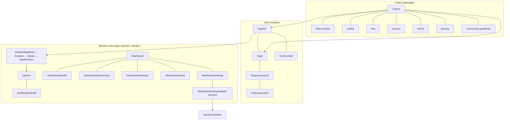
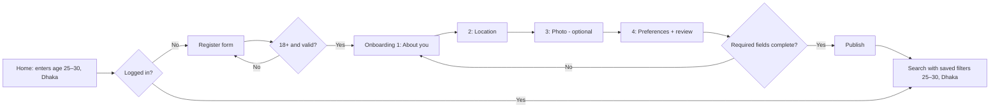
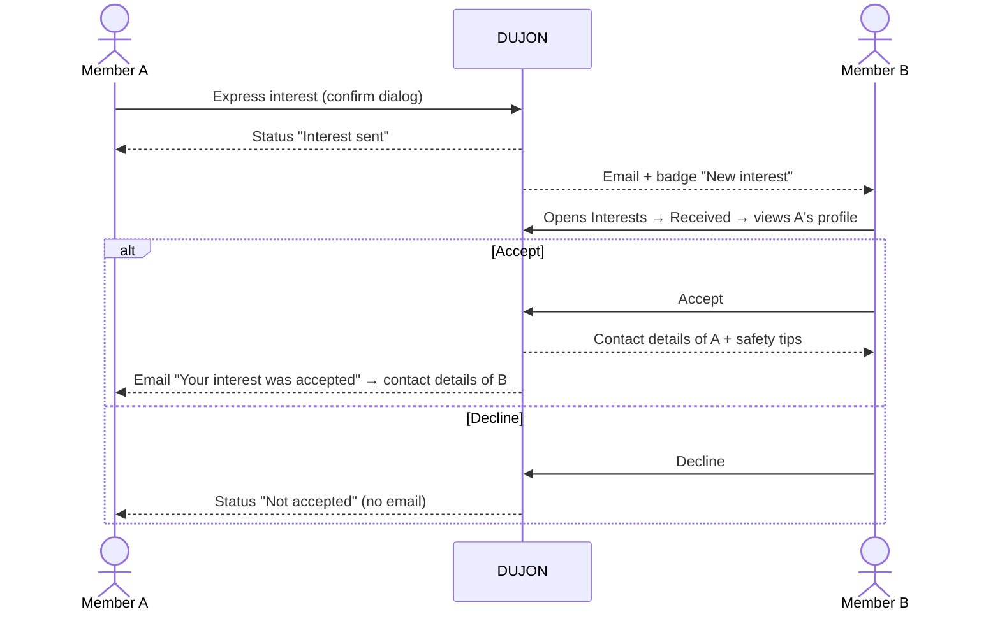

# 04 — UX/UI Blueprint

| Field | Value |
|---|---|
| Product | DUJON (দুজন) |
| Version | 1.0 (draft) |
| Date | 20 November 2026 |
| Status | Awaiting owner approval |

All routes below exist in Bangla at the root (`/…`) and in English under `/en/…`. Route slugs are English in both locales for clean, stable URLs.

---

## 1. Sitemap

## 2. Navigation

| Context | Desktop (≥ 1024 px) | Mobile (< 768 px) |
|---|---|---|
| Guest header | Logo · How it works · Safety · FAQ · Contact · বাংলা \| English · Log in · **Create profile** (primary) | Logo · language switch · Menu button (drawer with same links) · sticky "Create profile" CTA on home |
| Member header | Logo · Search · Interests (badge = pending received) · Saved · Dashboard (avatar menu: My profile, Settings, Log out) · language switch | Logo · language switch; **bottom tab bar**: Search · Interests · Saved · Profile (dashboard) |
| Footer (all) | About links, Safety, FAQ, Contact, Terms, Privacy, Community Guidelines, © DUJON, language switch | Same, stacked |

## 3. Key user journeys

### 3.1 New member: discover → register → publish → search

### 3.2 Interest → connection

### 3.3 Safety: block and report

Profile page → "⋯" menu → Report → reason + details + "Also block" (checked) → Submit → confirmation "Thank you. Our team will review this report." → profile disappears; user returns to search.

## 4. Screen inventory

| ID | Screen | Route | Access | Requirements |
|---|---|---|---|---|
| SCR-01 | Home | `/` | Public | FR-PUB-001, 002, 008, 009; FR-SEO-* |
| SCR-02 | How it works | `/how-it-works` | Public | FR-PUB-003 |
| SCR-03 | Safety & privacy | `/safety` | Public | FR-PUB-004, FR-SAFE-004, 005 |
| SCR-04 | FAQ | `/faq` | Public | FR-PUB-005, FR-SEO-007 |
| SCR-05 | Contact | `/contact` | Public | FR-PUB-006 |
| SCR-06 | Terms & Conditions | `/terms` | Public | FR-PUB-007 |
| SCR-07 | Privacy Policy | `/privacy` | Public | FR-PUB-007 |
| SCR-08 | Community Guidelines | `/community-guidelines` | Public | FR-PUB-007 |
| SCR-09 | Register | `/register` | Guest | FR-AUTH-001–005, 011, 013 |
| SCR-10 | Login | `/login` | Guest | FR-AUTH-006, 011, 012 |
| SCR-11 | Forgot password | `/forgot-password` | Guest | FR-AUTH-009 |
| SCR-12 | Reset password | `/reset-password` | Token | FR-AUTH-009 |
| SCR-13 | Email verification result | `/verify-email` | Token | FR-AUTH-010 |
| SCR-14 | Onboarding 1 — About you | `/onboarding/about` | Member | FR-PROF-001, 002, 006–008, 010 |
| SCR-15 | Onboarding 2 — Location | `/onboarding/location` | Member | FR-PROF-001, FR-LOC-001–004 |
| SCR-16 | Onboarding 3 — Photo | `/onboarding/photo` | Member | FR-PHOTO-001–004, 007 |
| SCR-17 | Onboarding 4 — Preferences & publish | `/onboarding/preferences` | Member | FR-PREF-001, 002, FR-PROF-003 |
| SCR-18 | Search / Discover | `/search` | Published member | FR-DISC-001–010, 012, 013, FR-PREF-003, FR-SAVE-001 |
| SCR-19 | Profile detail | `/profiles/[publicId]` | Published member | FR-DISC-011, FR-INT-001–008, FR-SAVE-001, FR-SAFE-001, 003, 004, 006, FR-PHOTO-003, 005 |
| SCR-20 | Dashboard overview | `/dashboard` | Member | FR-DASH-001, 002, FR-AUTH-010 |
| SCR-21 | My profile (edit, photo, publish/hide, preview) | `/dashboard/profile` | Member | FR-PROF-002–009, FR-PHOTO-001–007 |
| SCR-22 | Partner preferences | `/dashboard/preferences` | Member | FR-PREF-001 |
| SCR-23 | Interests (Received / Sent / Connections tabs) | `/dashboard/interests?tab=` | Member | FR-INT-004–010, FR-SAFE-001 |
| SCR-24 | Saved profiles | `/dashboard/saved` | Published member | FR-SAVE-001–003 |
| SCR-25 | Settings | `/dashboard/settings` | Member | FR-ACC-001–004, 006, FR-SAFE-002, FR-I18N-003 |
| SCR-26 | Delete account | `/dashboard/settings/delete-account` | Member | FR-ACC-005 |
| SCR-27 | Account deleted confirmation | `/account-deleted` | Public (noindex) | FR-ACC-005 |
| SCR-28 | 404 / error | any | Public | FR-PUB-010 |
| MOD-01 | Express-interest confirmation dialog | (on SCR-19/18) | Member | FR-INT-001 |
| MOD-02 | Report dialog | (on SCR-19/23) | Member | FR-SAFE-003, 006 |
| MOD-03 | Block confirmation dialog | (on SCR-19/23) | Member | FR-SAFE-001 |
| MOD-04 | Filter sheet (mobile) | (on SCR-18) | Member | FR-DISC-003–007 |

## 5. Screen specifications and wireframe descriptions

Wireframes are described top-to-bottom at mobile width (360–430 px); desktop differences follow.

### SCR-01 Home
1. **Header** (guest variant).
2. **Hero** — H1: "সহজে খুঁজুন আপনার মনের মতো জীবনসঙ্গী" ; supporting line; primary CTA "বিনামূল্যে প্রোফাইল তৈরি করুন"; secondary link "কীভাবে কাজ করে". Right/below: illustrative editorial photo (IMG-01), marked illustrative in the image inventory.
3. **Search entry card** — "আমি খুঁজছি" (Bride/Groom implicit from login; for guests just "Find a life partner"), Age from–to (two selects), Division, District, Upazila/Thana (cascading), "খুঁজুন" button. Desktop: single horizontal row inside the hero.
4. **How it works** — 3 numbered steps with simple line icons: Create profile → Search by age & area → Express interest & connect.
5. **Why DUJON** — 3–4 tiles: Privacy first (contact only after both agree), Simple (four filters, short profile), Respectful (community guidelines), Bangla first.
6. **Safety strip** — honest statement: "আমরা এখনো পরিচয় যাচাই করি না…" + link to Safety page.
7. **Success stories** — "সফলতার গল্প শীঘ্রই আসছে" card with soft illustration; no names, quotes, ratings or photos.
8. **FAQ teaser** — 4 questions (accordion) + "সব প্রশ্ন দেখুন".
9. **Final CTA band**.
10. **Footer**.
Desktop: hero two-column (text left, image right); tiles in 3–4 columns.

### SCR-02 How it works / SCR-03 Safety / SCR-04 FAQ / SCR-06–08 Legal
Article layout, max text width 68ch (≈ 720 px), table of contents on desktop for legal pages, "Last updated / version" line. Safety page sections: What we do · What we do not do yet (no identity verification) · Tips before meeting · How to report and block · Contact. FAQ: accordion grouped (Account, Profile, Search, Interests & contact, Privacy & safety).

### SCR-05 Contact
Form card (name, email, mobile optional, subject select, message with counter), privacy note, success state replacing the form. Desktop: form left, support info right (email address, expected response time "TBD by owner").

### SCR-09 Register
Single column card (max 480 px). Fields in order: Full name → Email → Mobile (optional, helper: "শুধু সংযুক্ত সদস্যরা দেখবেন") → Password (show/hide, strength hint) → Gender (two large radio cards: পুরুষ / নারী) → Date of birth (**three selects: Day / Month / Year**, year list from current−18 down to current−100 — easier than a calendar picker for all literacy levels) → Agreement checkbox with links → "অ্যাকাউন্ট তৈরি করুন". Below: "Already have an account? Log in". Note under gender + DOB: "These can't be changed later."

### SCR-10 Login / SCR-11 Forgot / SCR-12 Reset / SCR-13 Verify
Minimal centered cards. Reset: new password + confirm. Verify: success, expired (with resend), or already-verified states.

### SCR-14 – SCR-17 Onboarding
Stepper at top ("ধাপ ১/৪"), progress bar, one topic per step, sticky bottom bar with "Back" and "Save & continue". Step 3 has "Skip for now". Step 4 shows a summary card of the profile (as others will see it), publish checklist, and "প্রোফাইল প্রকাশ করুন" button; success → toast + redirect to `/search`.

### SCR-18 Search
- Mobile: top bar with result count and **"Filters (n)"** button opening MOD-04 bottom sheet (Age from/to, Division, District, Upazila/Thana, Apply, Clear). Active filters shown as removable chips under the top bar.
- Desktop: left sidebar filter panel (sticky), results grid on the right.
- Results: card grid — 1 column (< 640 px), 2 (≥ 640), 3 (≥ 1024), 4 (≥ 1440).
- **Profile card:** 4:5 photo area (or placeholder) · name + age on one line · "District, Division" · occupation · education level · marital status chip · "Managed by parent" badge if applicable · heart Save icon button (top-right of photo) · whole card links to profile.
- Pagination: Previous / page numbers (max 5 visible) / Next; on mobile, Previous/Next with "Page 2 of 7".
- Banners: email-not-verified banner (persistent, dismissible per session).
- Empty and cold-start states per SRS §7.

### SCR-19 Profile detail
- Mobile: photo (or placeholder) full width with rounded bottom; name, age, location; badges; action bar **sticky at bottom**: primary "আগ্রহ প্রকাশ করুন" (or status/Accept) + Save icon + "⋯" (Block, Report).
- Sections (cards): About · Basic details (marital status, height, education, occupation) · Location (division, district, upazila/thana) · Family (if provided) · Partner preference summary (age range, area) — shown because it helps both sides judge fit.
- Connected state: **Contact card** at top with email, mobile (tap-to-call / mailto), and safety tips link.
- Desktop: two columns — left photo + actions (sticky), right details.
- Interest button states: Express interest · Interest sent (Withdraw) · They're interested in you (Accept / Decline) · Connected · Not accepted (disabled, shows "You can try again after {date}") · Verify email to express interest (disabled with link).

### SCR-20 Dashboard overview
Greeting · profile status card (Draft/Published/Hidden with action) · completion checklist (Basic info, Location, Photo (optional), Preferences, Email verified) · three stat tiles (Pending interests, Connections, Saved) · quick links (Search, Edit profile).

### SCR-21 My profile
Sections with in-place edit forms: Photo (upload/replace/delete + visibility radio) · About you · Location · Read-only gender and DOB with "Need to correct these? Contact us" · Publish/Hide toggle with explanation · "Preview my profile" link (opens SCR-19 in preview mode).

### SCR-22 Preferences
Age range (two selects) · optional Division/District/Upazila · Save. Note: "Preferences only set your default search; they do not hide you from anyone."

### SCR-23 Interests
Tabs: Received (count) · Sent · Connections. Each row: thumbnail, name, age, location, date, status, actions (View, Accept, Decline / Withdraw / View contact). Overflow menu: Block, Report.

### SCR-24 Saved
Same card grid as search; unsave action; empty state.

### SCR-25 Settings
Sections: Language · Email notifications (2 toggles) · Mobile number · Change password · Blocked members (list with Unblock) · Log out of all devices · Danger zone: Delete account (link to SCR-26). Email shown read-only with "To change your email, contact us".

### SCR-26 Delete account
Explanation of what happens (profile hidden immediately, data permanently deleted after 30 days, cannot be undone), password field, type-to-confirm field, red "Delete my account" button.

## 6. Responsive rules

| Breakpoint | Width | Layout rules |
|---|---|---|
| Small mobile | 360–389 px | Base design. Single column, 16 px side padding, bottom tab bar (members), filter bottom sheet, 16 px min body text |
| Large mobile | 390–639 px | Same as small; card images slightly larger |
| Tablet | 640–1023 px (`sm`/`md`) | 2-column results; header shows primary links from 768 px; filters still in sheet below 1024 px |
| Laptop | 1024–1279 px (`lg`) | Sidebar filters + 3-column results; dashboard sidebar replaces bottom tabs |
| Desktop | ≥ 1280 px (`xl`) | Max content width 1200 px centred; 3 columns (4 from 1440 px) |

Rules: no horizontal scrolling at 320 px; touch targets ≥ 44×44 px; sticky elements never cover focused inputs (scroll-padding); Bangla text never truncated mid-conjunct — use line-clamp on whole lines.

## 7. Design system

### 7.1 Design tokens (proposed — validate contrast with a checker before freeze)

| Token | Value | Use |
|---|---|---|
| `color.bg` | `#FBF8F3` (warm ivory) | Page background |
| `color.surface` | `#FFFFFF` | Cards, inputs |
| `color.surface-muted` | `#F3EEE7` | Section bands, chips |
| `color.border` | `#E5DDD3` | Dividers, input borders |
| `color.text` | `#1F1B1A` (charcoal) | Body text |
| `color.text-muted` | `#5E5754` | Secondary text (≈ 7:1 on white) |
| `color.accent` | `#7A2E3B` (muted burgundy) | Primary buttons, links, focus ring (≈ 9:1 on white) |
| `color.accent-hover` | `#63242F` | Hover/pressed |
| `color.accent-soft` | `#F4E4E6` | Selected chips, soft highlights |
| `color.success` | `#2F6B4F` | Success states |
| `color.warning` | `#8A5A00` | Warnings (on `#FFF4DB`) |
| `color.danger` | `#B3261E` | Errors, destructive actions |
| `radius.sm/md/lg/full` | 6 / 10 / 16 / 9999 px | Inputs / buttons / cards / chips |
| `shadow.card` | `0 1px 2px rgb(31 27 26 / 6%), 0 4px 12px rgb(31 27 26 / 6%)` | Cards |
| `space` | 4 px base scale: 4, 8, 12, 16, 24, 32, 48, 64, 96 | Spacing |
| `motion.duration` | 150 ms (micro), 250 ms (sheets/dialogs) | Respect `prefers-reduced-motion` |

### 7.2 Typography
- Bangla: **Noto Sans Bengali** (wide conjunct coverage, good screen readability). English: **Inter**. Both self-hosted via `next/font` (no runtime Google request), subset, `font-display: swap`.
- Font stack applies Bangla font first in `bn` and Inter first in `en`, each falling back to the other.
- Scale (mobile → desktop): H1 28→40 px, H2 22→30, H3 18→22, body 16→17, small 14. Line height 1.6 for Bangla body text (taller glyphs), 1.5 for English.
- No all-caps for Bangla; avoid letter-spacing on Bangla text.

### 7.3 Visual rules
Generous whitespace; one primary CTA per view; burgundy only for actions and key accents; photography warm and natural; line icons (Lucide) at 20/24 px; no glassmorphism, heavy gradients, swipe gestures or heart-explosion animations.

## 8. Component inventory

| Component | Notes | Used in |
|---|---|---|
| `Button` (primary, secondary, ghost, danger; sizes md/lg) | Loading state with spinner and `aria-busy` | All |
| `IconButton` | Requires `aria-label` | Save, menus |
| `TextField`, `Textarea` (with counter), `PasswordField` | Label always visible, helper + error text | Forms |
| `Select` | Native `<select>` for accessibility and mobile pickers | Location, age, DOB |
| `DateOfBirthField` | Day/Month/Year selects, localized month names | SCR-09 |
| `RadioCardGroup` | Gender, photo visibility, managed-by | SCR-09, 14, 21 |
| `Checkbox`, `Switch` | Terms, notifications | SCR-09, 25 |
| `LocationCascade` | Division → District → Upazila with clearing logic | SCR-01, 15, 18, 22 |
| `AgeRangeField` | Two selects with min ≤ max validation | SCR-01, 17, 18, 22 |
| `FormErrorSummary` | Focused on submit failure, links to fields | All forms |
| `Alert` / `Banner` | info, success, warning, danger | Verification, cold start |
| `Toast` | Polite live region | Save, publish |
| `Dialog` (Radix) | Focus trap, ESC, return focus | MOD-01–03 |
| `Sheet` | Mobile filter bottom sheet | MOD-04 |
| `Tabs` | Interests | SCR-23 |
| `Accordion` | FAQ | SCR-01, 04 |
| `ProfileCard` | Card spec in SCR-18 | SCR-18, 24 |
| `ProfilePhoto` | Handles placeholder + visibility; `alt` = "{name}'s profile photo" | Cards, detail |
| `Badge` / `Chip` | Managed-by, status, active filters | Cards, detail |
| `InterestActions` | All interest states | SCR-19, 23 |
| `ContactCard` | Revealed contacts + safety tips | SCR-19, 23 |
| `Pagination` | Accessible nav landmark | SCR-18 |
| `Skeleton`, `EmptyState` | Loading/empty | Lists |
| `Stepper` | Onboarding | SCR-14–17 |
| `LanguageSwitcher` | `বাংলা | English`, `lang` attributes on each label | Header/footer |
| `SiteHeader`, `SiteFooter`, `MemberTabBar`, `DashboardSidebar` | Layout | All |

## 9. Image inventory

All imagery other than member uploads is **illustrative**. Source and licence must be recorded in `public/images/LICENSES.md` before launch. No image may be used as, or near text implying, a real member, couple or testimonial.

| ID | Page / slot | Purpose | Style | Aspect / size (rendered max) | Alt (bn) | Alt (en) | Source / licence | Type |
|---|---|---|---|---|---|---|---|---|
| IMG-01 | Home hero | Emotional warmth | Natural, understated photo of an adult Bangladeshi/South Asian couple or two adults in a respectful, everyday setting; soft daylight | 4:5 mobile, 5:4 desktop; 1200 px wide max | "দুজন মানুষ হাসিমুখে কথা বলছেন" | "Two people smiling and talking" | TBD: licensed stock or generated editorial (record prompt/licence) | Illustrative |
| IMG-02 | Home "How it works" | Step icons | Line icons, not photos | 48 px | decorative (`alt=""`) | decorative | Lucide (ISC licence) | Illustrative |
| IMG-03 | Home "Why DUJON" | Supporting image | Hands/tea cups/family table detail — no faces needed | 3:2, 800 px | "পরিবারের সঙ্গে চায়ের আড্ডা" | "Tea with family" | TBD | Illustrative |
| IMG-04 | Success stories placeholder | Soft illustration | Abstract floral/line illustration, no people | 16:9, 800 px | decorative | decorative | Commissioned/own SVG | Illustrative |
| IMG-05 | Safety page | Reassurance | Illustration of a shield/lock (no people) | 1:1, 400 px | decorative | decorative | Own SVG | Illustrative |
| IMG-06 | Profile placeholder | No-photo avatar | Neutral silhouette-free illustration (initial letter on soft background) | 1:1 / 4:5 | "{নাম}-এর ছবি দেওয়া নেই" | "No photo for {name}" | Generated in code | System |
| IMG-07 | Empty states | Search, interests, saved | Simple line illustrations | 1:1, 240 px | decorative | decorative | Own SVG | Illustrative |
| IMG-08 | Open Graph image | Social sharing | Logo + tagline on ivory, **no people** | 1200×630 | n/a | n/a | Own design | Brand |
| IMG-09 | Member photos | Profiles | User uploads only | 4:5 full 800 px; thumb 320 px square | "{নাম}-এর প্রোফাইল ছবি" | "{name}'s profile photo" | Member upload with consent (Terms) | Real user content |

Rules: responsive `srcset` via `next/image`; hero `priority`, all others lazy; WebP/AVIF; no images of minors; avoid stereotyped or exaggerated AI-looking faces.

## 10. Accessibility checklist (design)
- Colour never the only signal (status chips have text).
- Focus ring 2 px `color.accent` + 2 px offset on all interactive elements.
- `lang="bn"` / `lang="en"` on `<html>`; mixed-language labels marked with `lang`.
- Every form field has a visible label; required fields marked with text "(আবশ্যক)" not only `*`.
- Dialogs: focus trap, labelled title, ESC closes, focus returns.
- Reduced motion respected.
