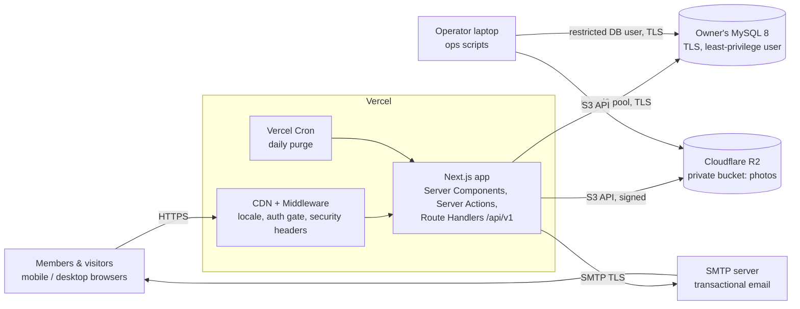
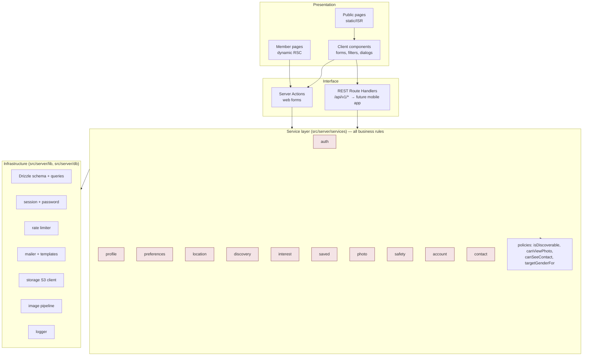
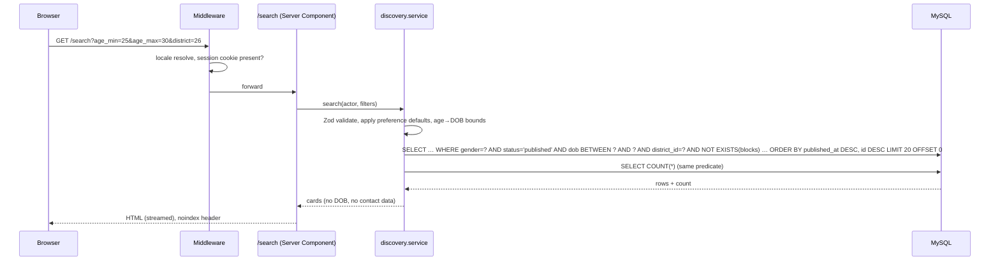

# 06 — Technical Architecture

| Field | Value |
|---|---|
| Product | DUJON (দুজন) |
| Version | 1.0 (draft) |
| Date | 20 November 2026 |
| Status | Awaiting owner approval |

---

## 1. Chosen stack and rationale

Pin exact versions in `package.json` at project start; use the latest stable releases at that time and record them in `12-local-setup-github-vercel-deployment.md`.

| Layer | Choice | Why | Trade-off / alternative considered |
|---|---|---|---|
| Runtime | Node.js LTS (version supported by Vercel at project start) | Long-term support; required by `sharp` and `argon2` native modules | — |
| Framework | **Next.js (App Router) + TypeScript (strict)** | One codebase for SEO-friendly server-rendered public pages, member pages and REST API; first-class on Vercel; Server Components reduce client JS | Separate SPA + API server: more moving parts, worse SEO, more hosting |
| Styling | **Tailwind CSS** | Design tokens as CSS variables; small CSS output; fast iteration | CSS Modules: more boilerplate |
| UI primitives | **Radix UI primitives** (via shadcn/ui-style copied components) + **Lucide** icons | Accessible dialogs, tabs, accordions without a heavy design library; components are owned in the repo | Full component libraries (MUI etc.) heavier and harder to make look bespoke |
| i18n | **next-intl** | App Router support, ICU messages, locale-prefixed routing with Bangla default unprefixed | Hand-rolled i18n: error-prone |
| Database | **MySQL 8.0+** (owner's server) [CONFIRMED] | Required by owner; relational constraints fit the data | MariaDB on shared hosts is *not* a target — verify server is MySQL 8 (CHECK constraints, `utf8mb4_0900_ai_ci`) |
| ORM / migrations | **Drizzle ORM + drizzle-kit** with `mysql2` driver | Thin, SQL-transparent queries (important for the discovery query and index use); no separate query-engine binary, small cold starts on serverless; explicit pool control; SQL migration files reviewable in Git | **Prisma**: excellent DX and migrations, but heavier runtime and less direct control of connection pooling on serverless + external MySQL. Either is viable; Drizzle chosen for pooling control and query transparency |
| Validation | **Zod** | One schema shared by browser forms, Server Actions and API handlers | — |
| Forms | **React Hook Form** + Zod resolver (client), server re-validates | Accessible, low re-render forms; instant feedback for low-literacy users | Pure Server Actions: fine for simple forms (contact, login) — allowed there |
| Auth | **Custom session-based auth** (opaque token cookie + `sessions` table), **Argon2id** (`@node-rs/argon2`) | Database sessions are revocable (logout everywhere, suspension); same table can later issue bearer tokens to the mobile app; small, auditable code following the widely used "Lucia guide" pattern | **Auth.js credentials provider** pushes towards JWT sessions (not instantly revocable) and adds complexity we don't need without OAuth |
| Image processing | **sharp** | Fast re-encode, resize, metadata stripping | — |
| Object storage | **Cloudflare R2 private bucket** (S3-compatible, `@aws-sdk/client-s3`) [OD-013] | Vercel has no persistent filesystem; R2 has no egress fees and a free tier (confirm current pricing); S3 API means we can switch to AWS S3, Backblaze B2, or MinIO on the owner's server without code changes | Owner's server storage via SFTP/API: possible but adds a custom upload service; Vercel Blob: simple but public-URL oriented |
| Email | **Nodemailer over SMTP** (owner's hosting mailbox) [OD-012] | No extra cost; switchable to a transactional provider (e.g. Resend, Amazon SES, Brevo) by changing env vars | Shared-host SMTP deliverability risk (R-12) |
| Rate limiting | **MySQL-backed fixed-window counters** | No extra service; adequate at MVP scale | Upstash Redis: faster, extra vendor — upgrade path |
| Scheduled jobs | **Vercel Cron** → protected route `/api/internal/cron/purge` (daily) | Built-in; one daily job is enough | Owner server cron calling the same route |
| Testing | **Vitest** (unit/integration), **Playwright** (E2E), **@axe-core/playwright** (a11y), **Lighthouse CI** (performance/SEO) | Standard, fast, CI-friendly | — |
| CI | **GitHub Actions** with MySQL 8 service container | Runs lint, type-check, migrations, tests, build on every PR | — |
| Hosting | **Vercel (Pro plan for commercial use)** + owner MySQL [OD-014] | Git-based deploys, previews, CDN, image optimisation | **Fallback:** run `next start` on owner's VPS/Node hosting next to MySQL (see §8) |
| Analytics | **Vercel Web Analytics + Speed Insights** (cookie-less) [OD-022] | Privacy-friendly; no cookie banner needed for analytics | Google Analytics: needs consent banner |

**Not used in MVP:** microservices, Redis, queues, search engines (Elasticsearch/Meilisearch), AI services, SMS, payment gateways, real-time sockets.

## 2. System context



## 3. Application architecture (layers and module boundaries)



**Rules**
1. UI components never query the database or contain business rules; they call Server Actions or the API.
2. Server Actions and Route Handlers are thin: authenticate → parse with Zod → call service with an `Actor` context `{ userId, profileId, role, locale }` → map result/errors.
3. Services are framework-agnostic TypeScript (no `next/*` imports) so the future admin panel and mobile API reuse them unchanged.
4. Eligibility/privacy policies (`isDiscoverable`, `canViewPhoto`, `canSeeContact`) exist once in `src/server/policies` and are used by every service.
5. Errors are thrown as typed `AppError(code, httpStatus, details)` and mapped to the standard error format (doc 08 §2).

### 3.1 Module map

| Module | Service | Main tables | Main API groups |
|---|---|---|---|
| AUTH | `auth.service` | users, sessions, auth_tokens, rate_limits | `/auth/*` |
| PROF | `profile.service` | profiles | `/me/profile*` |
| PREF | `preferences.service` | partner_preferences | `/me/preferences` |
| LOC | `location.service` | divisions, districts, upazilas | `/locations/*` |
| DISC | `discovery.service` | profiles, users, blocks, profile_photos, saved_profiles, interests | `/profiles`, `/profiles/{id}` |
| INT | `interest.service` | interests | `/interests*`, `/connections` |
| SAVE | `saved.service` | saved_profiles | `/me/saved*` |
| PHOTO | `photo.service` | profile_photos (+ R2) | `/me/photo`, `/photos/*` |
| SAFE | `safety.service` | blocks, reports, moderation_actions | `/me/blocks*`, `/reports` |
| DASH | `dashboard.service` (read model) | multiple | `/me/dashboard` |
| ACC | `account.service` | users, sessions | `/me/account*` |
| PUB | `contact.service` | contact_messages | `/contact` |
| SEO | (Next.js metadata, sitemap, robots) | — | — |

### 3.2 Proposed repository structure

```text
dujon/
├─ docs/                         # this documentation pack
├─ messages/ bn.json en.json     # UI copy
├─ data/locations/               # bd-locations.v1.json + MANIFEST.md
├─ drizzle/                      # generated SQL migrations (committed)
├─ public/images/ LICENSES.md    # illustrative images + licence records
├─ scripts/
│  ├─ seed-locations.ts
│  ├─ seed-demo.ts               # DEMO data only, refuses to run in production
│  ├─ check-i18n.ts
│  └─ ops/ reports.ts show.ts suspend.ts unsuspend.ts remove-photo.ts resolve-report.ts
├─ src/
│  ├─ app/
│  │  ├─ [locale]/
│  │  │  ├─ (public)/ page.tsx how-it-works/ safety/ faq/ contact/ terms/ privacy/ community-guidelines/
│  │  │  ├─ (auth)/ register/ login/ forgot-password/ reset-password/ verify-email/
│  │  │  ├─ (member)/ onboarding/ search/ profiles/[publicId]/ dashboard/…
│  │  │  └─ account-deleted/
│  │  ├─ api/v1/…                # REST route handlers
│  │  ├─ api/internal/cron/purge/route.ts
│  │  ├─ sitemap.ts robots.ts
│  ├─ components/ ui/ (primitives)  features/ (ProfileCard, LocationCascade…)
│  ├─ config/app.ts               # configuration (doc 03 §2)
│  ├─ i18n/ routing.ts request.ts
│  ├─ lib/validation/             # shared Zod schemas (client + server)
│  ├─ server/
│  │  ├─ db/ schema.ts client.ts
│  │  ├─ services/ *.service.ts
│  │  ├─ policies/ discovery.ts photo.ts contact.ts
│  │  └─ lib/ age.ts session.ts password.ts rate-limit.ts text-guard.ts errors.ts mailer/ storage.ts image.ts logger.ts
│  └─ middleware.ts               # locale + auth gate + headers (file name per Next.js version)
├─ tests/ unit/ integration/ e2e/
├─ .env.example
└─ README.md
```

## 4. Key data flows

### 4.1 Search request



### 4.2 Photo upload
Browser → `POST /api/v1/me/photo` (multipart) → session + rate limit → size/type check → `sharp` pipeline (strip metadata, resize, WebP) → `PutObject` ×2 to R2 private bucket → DB transaction (insert new, mark old) → delete old objects → response with new photo metadata. Photos are read via `GET /api/v1/photos/{id}/{size}` which applies `canViewPhoto` and streams the object (or redirects to a 60-second presigned URL).

### 4.3 Interest accept
`POST /api/v1/interests/{id}/accept` → `interest.service.accept(actor, id)` → transaction: lock interest row `FOR UPDATE`, verify recipient + pending + no block → update → commit → send email (after commit; failures logged, not rolled back).

## 5. Authentication and authorisation approach

- **Session cookie** `dujon_session`: 256-bit random token; DB stores SHA-256 hash; `HttpOnly; Secure; SameSite=Lax; Path=/`; 30-day sliding expiry.
- **Middleware** performs a cheap check (cookie present) for member routes and redirects guests to `/login?next=…`; **real validation** happens in the server layer (`getActor()`), which loads the session + user status on every request (one indexed query).
- **CSRF:** Server Actions are protected by Next.js origin checks; REST mutation handlers verify `Origin`/`Host` match and require `Content-Type: application/json` or `multipart/form-data`; SameSite=Lax cookies add defence.
- **Future mobile app:** same `sessions` table issues tokens returned in the response body and sent as `Authorization: Bearer <token>`; `getActor()` accepts either source. No schema change needed.
- **Roles:** `users.role` (`user` | `admin`). MVP code paths only allow `user`; an `admin` role check helper exists for the future admin panel.

## 6. Image storage approach

| Aspect | Decision |
|---|---|
| Location | Private R2 bucket `dujon-photos-<env>`; separate buckets for development/preview/production |
| Keys | `photos/{uuid}/full.webp`, `photos/{uuid}/thumb.webp` — no names, IDs or emails |
| Access | Only via app route with policy check; no public bucket URL; presigned URLs (if used) expire in 60 s |
| Processing | Server-side `sharp`; metadata removed; max 800 px |
| Credentials | Bucket-scoped API token with object read/write only |
| Deletion | Immediate on replace/delete/purge; daily purge retries orphans |
| Next.js `<Image>` | Not used for member photos (avoids public optimisation cache); plain `` with fixed dimensions and lazy loading. `next/image` used for illustrative/public images |

## 7. MySQL on Vercel — connection approach

Serverless functions can open many connections quickly. Rules:

1. **One module-level pool per function instance** (`mysql2/promise.createPool`) with `connectionLimit` **2–3**, `maxIdle` 1, `idleTimeout` 30 s, `enableKeepAlive: true`, `waitForConnections: true`, `queueLimit` 50.
2. Enable Vercel **Fluid Compute** (instance reuse) and register the pool with Vercel's helper for draining idle pool connections before an instance is suspended (`attachDatabasePool` from `@vercel/functions` — confirm the current API in Vercel docs at build time).
3. **Region:** set the Vercel Functions region nearest to the MySQL server (e.g. `sin1` Singapore if the DB is in Asia; measure latency with the connectivity test in doc 12). Every query round-trip pays this latency, so pages must use few, combined queries.
4. **Capacity check:** `max_connections` and per-user `max_user_connections` on the owner's server must exceed `(expected concurrent instances × connectionLimit) + ops + cron`. Shared hosting often limits per-user connections to a low number — **verify before choosing Vercel** (R-03).
5. **Security:** remote access restricted to TLS (`REQUIRE SSL` on the DB user, `ssl: { rejectUnauthorized: true }`); Vercel egress IPs are dynamic on standard plans, so IP allow-listing is usually not possible → use a strong random password, TLS, a dedicated least-privilege user, and non-default port if the host allows. (Vercel offers static egress IPs on some paid plans — owner to check cost.)
6. **Users:** `dujon_app` (SELECT/INSERT/UPDATE/DELETE on app tables only), `dujon_migrate` (DDL, used only from CI/locally for migrations), `dujon_ops` (SELECT on most tables, UPDATE on users/profiles/reports status columns, INSERT on moderation_actions).
7. **Timeouts:** query timeout 5 s for page queries; slow query log reviewed weekly.

## 8. Deployment alternatives (if §7 checks fail)

| Option | When | Notes |
|---|---|---|
| A. Vercel + owner MySQL (default) | Remote TLS access allowed; connection limits sufficient; latency < ~60 ms | Simplest operations |
| B. Next.js on owner's VPS (Node 20+/PM2 or Docker) next to MySQL | Shared host forbids remote DB, or latency too high | Same codebase (`next build && next start`); add Nginx, HTTPS (Let's Encrypt), cron for purge; GitHub Actions deploys over SSH |
| C. Vercel + managed MySQL (e.g. a MySQL-compatible cloud DB in a nearby region) | Owner prefers managed DB | Extra monthly cost; still MySQL [CONFIRMED requirement] |

Any change from option A requires owner approval (OD-014).

## 9. Rendering and caching strategy

| Route type | Rendering | Cache |
|---|---|---|
| Public marketing/legal | Static generation per locale | CDN, revalidate on deploy |
| Locations API | Dynamic, public data | `Cache-Control: public, s-maxage=86400` |
| Member pages, API | Dynamic per request | `Cache-Control: private, no-store` |
| Photos | Dynamic, authorised | `private, max-age=300` |

## 10. Security headers (set in middleware / `next.config`)

`Strict-Transport-Security: max-age=63072000; includeSubDomains` · `Content-Security-Policy` (self, nonce-based scripts, `img-src 'self' data: blob:`, `connect-src 'self' <analytics>`, `frame-ancestors 'none'`) · `X-Content-Type-Options: nosniff` · `Referrer-Policy: strict-origin-when-cross-origin` · `Permissions-Policy: camera=(), microphone=(), geolocation=()` · `X-Frame-Options: DENY`.

## 11. Future extensibility

| Future capability | Prepared by |
|---|---|
| Admin panel | `users.role`, `profiles.status`, `profile_photos.moderation_status`, `reports` status workflow, `moderation_actions` audit table, services independent of UI |
| Identity verification | Add `identity_verifications` table + `profiles.verification_level`; UI badge only after real process |
| Mobile app | `/api/v1` REST + bearer sessions; consistent error codes; pagination contract |
| More languages | next-intl locales; location name columns per locale (or translation table) |
| International/diaspora | Add `countries` table above divisions; locations become country-scoped |
| Broader gender/discovery settings | `targetGenderFor()` single policy function; add `seeking` column later without rewriting profiles |
| Paid plans | Separate `subscriptions` module; no payment logic leaks into existing services |
| Testimonials | Future `testimonials` table with consent fields (doc 07 §8) |
