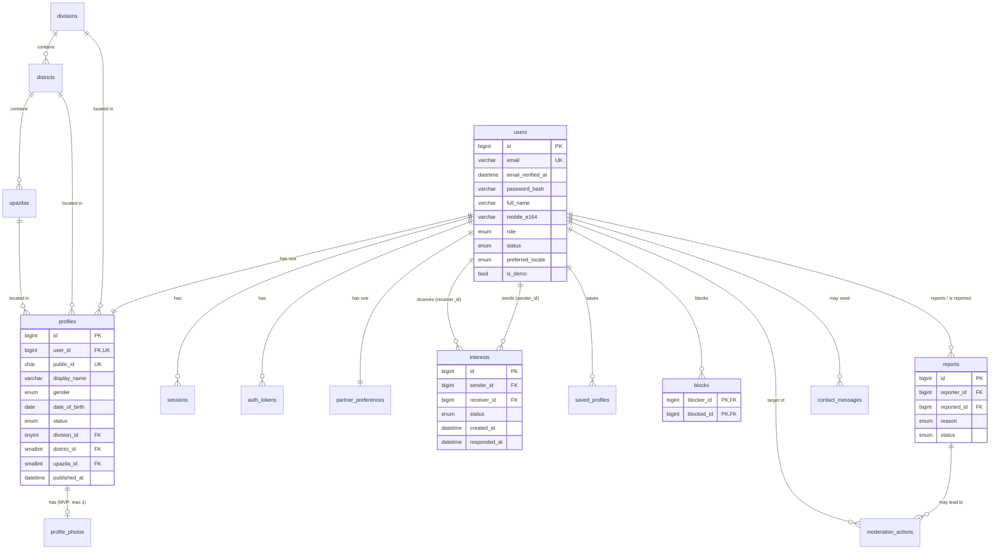

# 07 — Database Design (MySQL 8)

| Field | Value |
|---|---|
| Product | DUJON (দুজন) |
| Version | 1.0 (draft) |
| Date | 20 November 2026 |
| Status | Awaiting owner approval |

---

## 1. Conventions

- Engine **InnoDB**, charset **utf8mb4**, collation **utf8mb4_0900_ai_ci** (MySQL 8.0+). Bangla text is stored as UTF-8; `VARCHAR(n)` limits are in characters.
- Table names plural snake_case; primary keys `id BIGINT UNSIGNED AUTO_INCREMENT` unless noted.
- Timestamps `DATETIME(3)` stored in **UTC**; business dates (DOB) as `DATE`. Application converts to Asia/Dhaka for business rules.
- Internal numeric IDs are **never exposed** in URLs; profiles and photos use random `public_id` values.
- **Users are never hard-deleted** — they are anonymised at purge (§7). This keeps foreign keys and safety records intact while removing personal data.
- Migrations: drizzle-kit generates SQL files in `drizzle/`, reviewed and committed. Never edit production schema by hand.
- MySQL ≥ 8.0.16 required (CHECK constraints are enforced from this version).

Sensitivity classes used in the data dictionary:
**S0** public reference data · **S1** visible to eligible members · **S2** private personal data (owner + connections or nobody) · **S3** secret (credentials, token hashes) · **S4** safety/moderation (operator only).

## 2. Entity-relationship diagram



## 3. Tables

### 3.1 `users` — accounts and credentials
**Purpose:** login identity, account status, preferences, consent record. Supports FR-AUTH-*, FR-ACC-*, FR-I18N-003.

| Column | Type | Null | Default | Notes | Class |
|---|---|---|---|---|---|
| id | BIGINT UNSIGNED | no | AI | PK | — |
| email | VARCHAR(254) | no | | lower-case; **UNIQUE** `uq_users_email`; replaced by `deleted+{id}@invalid.dujon` at purge | S2 |
| email_verified_at | DATETIME(3) | yes | NULL | account (not identity) verification | S2 |
| password_hash | VARCHAR(255) | yes | | Argon2id encoded string; NULL after purge | S3 |
| full_name | VARCHAR(80) | yes | | never shown to members; NULL after purge | S2 |
| mobile_e164 | VARCHAR(16) | yes | NULL | `+8801XXXXXXXXX`; shown only to connections | S2 |
| role | ENUM('user','admin') | no | 'user' | admin reserved for future | S4 |
| status | ENUM('active','suspended','pending_deletion','deleted') | no | 'active' | | S4 |
| preferred_locale | ENUM('bn','en') | no | 'bn' | | S2 |
| notify_interest_received | TINYINT(1) | no | 1 | | S2 |
| notify_interest_accepted | TINYINT(1) | no | 1 | | S2 |
| terms_version | VARCHAR(20) | no | | e.g. `2026-11-v1` | S2 |
| privacy_version | VARCHAR(20) | no | | | S2 |
| terms_accepted_at | DATETIME(3) | no | | | S2 |
| is_demo | TINYINT(1) | no | 0 | demo seed marker; must be 0 for all rows in production | S4 |
| last_login_at | DATETIME(3) | yes | | | S4 |
| deletion_requested_at | DATETIME(3) | yes | | | S4 |
| deleted_at | DATETIME(3) | yes | | set at purge | S4 |
| created_at / updated_at | DATETIME(3) | no | CURRENT_TIMESTAMP(3) | | — |

Indexes: `uq_users_email(email)`, `idx_users_status_deletion(status, deletion_requested_at)`.
Retention: personal columns nulled/replaced 30 days after deletion request; row kept as tombstone.

### 3.2 `sessions`
**Purpose:** server-side sessions (FR-AUTH-007/008).

| Column | Type | Null | Notes | Class |
|---|---|---|---|---|
| id | CHAR(64) | no | PK = SHA-256 hex of the cookie token (raw token never stored) | S3 |
| user_id | BIGINT UNSIGNED | no | FK → users.id ON DELETE CASCADE | — |
| expires_at | DATETIME(3) | no | | — |
| created_at | DATETIME(3) | no | | — |
| last_used_at | DATETIME(3) | no | updated at most once per hour | — |
| user_agent | VARCHAR(255) | yes | truncated; for "your devices" in future | S2 |

Indexes: `idx_sessions_user(user_id)`, `idx_sessions_expires(expires_at)`. Retention: deleted on logout/expiry (daily purge).

### 3.3 `auth_tokens`
**Purpose:** single-use email verification and password reset tokens (FR-AUTH-009/010).

| Column | Type | Null | Notes | Class |
|---|---|---|---|---|
| id | BIGINT UNSIGNED | no | PK | — |
| user_id | BIGINT UNSIGNED | no | FK → users ON DELETE CASCADE | — |
| type | ENUM('email_verify','password_reset') | no | | — |
| token_hash | CHAR(64) | no | **UNIQUE**; SHA-256 of emailed token | S3 |
| expires_at | DATETIME(3) | no | | — |
| used_at | DATETIME(3) | yes | | — |
| created_at | DATETIME(3) | no | | — |

Indexes: `uq_auth_tokens_hash(token_hash)`, `idx_auth_tokens_user_type(user_id, type)`. Retention: purged 7 days after expiry/use.

### 3.4 `profiles`
**Purpose:** the shared profile model and discovery index (FR-PROF-*, FR-DISC-*).

| Column | Type | Null | Default | Notes | Class |
|---|---|---|---|---|---|
| id | BIGINT UNSIGNED | no | AI | PK | — |
| user_id | BIGINT UNSIGNED | no | | FK → users; **UNIQUE** | — |
| public_id | CHAR(12) | no | | random (lower-case letters + digits); **UNIQUE**; used in URLs | S1 |
| display_name | VARCHAR(40) | no | | | S1 |
| gender | ENUM('male','female') | no | | copied from registration; read-only | S1 |
| date_of_birth | DATE | no | | only age is displayed | S2 |
| created_by | ENUM('self','parent','guardian','sibling','relative') | no | 'self' | | S1 |
| marital_status | ENUM('never_married','divorced','widowed') | yes | | required to publish | S1 |
| height_cm | SMALLINT UNSIGNED | yes | | CHECK 120–220 | S1 |
| education_level | ENUM('below_ssc','ssc','hsc','diploma','bachelors','masters','doctorate','other') | yes | | required to publish | S1 |
| education_detail | VARCHAR(100) | yes | | | S1 |
| occupation | VARCHAR(100) | yes | | required to publish | S1 |
| division_id | TINYINT UNSIGNED | yes | | FK → divisions | S1 |
| district_id | SMALLINT UNSIGNED | yes | | composite FK (district_id, division_id) → districts(id, division_id) | S1 |
| upazila_id | SMALLINT UNSIGNED | yes | | composite FK (upazila_id, district_id) → upazilas(id, district_id) | S1 |
| about | VARCHAR(1000) | yes | | required (≥ 30 chars) to publish | S1 |
| family_info | VARCHAR(500) | yes | | | S1 |
| photo_visibility | ENUM('members','connections') | no | 'members' | | S2 |
| status | ENUM('draft','published','hidden','suspended') | no | 'draft' | | S4 |
| onboarding_step | TINYINT UNSIGNED | no | 0 | 0–4 | — |
| published_at | DATETIME(3) | yes | | set on each publish | S1 |
| created_at / updated_at | DATETIME(3) | no | | | — |

Constraints: `CHECK (height_cm IS NULL OR height_cm BETWEEN 120 AND 220)`; hierarchy enforced by composite foreign keys (a district cannot be stored under the wrong division; an upazila cannot be stored under the wrong district).

Indexes (discovery):
- `idx_disc_base (status, gender, date_of_birth)`
- `idx_disc_division (status, gender, division_id, date_of_birth)`
- `idx_disc_district (status, gender, district_id, date_of_birth)`
- `idx_disc_upazila (status, gender, upazila_id, date_of_birth)`
- `idx_disc_recent (status, gender, published_at, id)` — unfiltered "newest" listing
- `uq_profiles_user (user_id)`, `uq_profiles_public (public_id)`

Note: with a DOB range plus `ORDER BY published_at`, MySQL sorts the filtered set (filesort). This is acceptable at MVP scale (target ≤ 50k published profiles, NFR-PERF-002); monitor with `EXPLAIN` and the slow log.

Retention: deleted at purge.

### 3.5 `profile_photos`
**Purpose:** metadata for the member's photo (FR-PHOTO-*). Files live in object storage.

| Column | Type | Null | Default | Notes | Class |
|---|---|---|---|---|---|
| id | BIGINT UNSIGNED | no | AI | PK | — |
| public_id | CHAR(16) | no | | random; **UNIQUE**; used in photo URLs | S1 |
| profile_id | BIGINT UNSIGNED | no | | FK → profiles ON DELETE CASCADE; **UNIQUE** in MVP (one photo) | — |
| storage_key_full | VARCHAR(200) | no | | `photos/{uuid}/full.webp` | S4 |
| storage_key_thumb | VARCHAR(200) | no | | | S4 |
| width / height | SMALLINT UNSIGNED | no | | of full image | — |
| bytes | INT UNSIGNED | no | | | — |
| moderation_status | ENUM('approved','pending','rejected') | no | 'approved' | MVP has no review queue; reserved | S4 |
| created_at | DATETIME(3) | no | | | — |

Retention: row and objects deleted on replace/delete/purge. To allow multiple photos later, drop the unique on `profile_id` and add `sort_order`, `is_primary`.

### 3.6 `divisions`, `districts`, `upazilas` — location reference (FR-LOC-*)

| Table | Columns | Keys / indexes | Class |
|---|---|---|---|
| divisions | `id TINYINT UNSIGNED PK`, `code VARCHAR(10) UNIQUE` (dataset ID), `name_en VARCHAR(60)`, `name_bn VARCHAR(60)` | `uq_divisions_code` | S0 |
| districts | `id SMALLINT UNSIGNED PK`, `division_id TINYINT UNSIGNED FK`, `code VARCHAR(10) UNIQUE`, `name_en`, `name_bn` | `idx_districts_division(division_id)`, `uq_districts_id_division(id, division_id)` (target of composite FK) | S0 |
| upazilas | `id SMALLINT UNSIGNED PK`, `district_id SMALLINT UNSIGNED FK`, `code VARCHAR(12) UNIQUE`, `name_en VARCHAR(80)`, `name_bn VARCHAR(80)`, `type ENUM('upazila','thana') DEFAULT 'upazila'`, `is_active TINYINT(1) DEFAULT 1` | `idx_upazilas_district(district_id)`, `uq_upazilas_id_district(id, district_id)` | S0 |

`is_active = 0` hides a renamed/abolished unit from selectors without breaking existing profiles.

### 3.7 `partner_preferences` (FR-PREF-*)

| Column | Type | Null | Notes |
|---|---|---|---|
| user_id | BIGINT UNSIGNED | no | PK, FK → users ON DELETE CASCADE |
| age_min | TINYINT UNSIGNED | no | CHECK ≥ 18 |
| age_max | TINYINT UNSIGNED | no | CHECK ≤ 100 and `age_min <= age_max` |
| division_id | TINYINT UNSIGNED | yes | FK |
| district_id | SMALLINT UNSIGNED | yes | composite FK as in profiles |
| upazila_id | SMALLINT UNSIGNED | yes | composite FK as in profiles |
| updated_at | DATETIME(3) | no | |

Class S1 (age range and area are shown on profile detail as "Looking for"). Retention: deleted at purge.

### 3.8 `interests` (FR-INT-*) — also represents connections (`status='accepted'`)

| Column | Type | Null | Default | Notes |
|---|---|---|---|---|
| id | BIGINT UNSIGNED | no | AI | PK |
| sender_id | BIGINT UNSIGNED | no | | FK → users |
| receiver_id | BIGINT UNSIGNED | no | | FK → users |
| status | ENUM('pending','accepted','declined','withdrawn','ended') | no | 'pending' | |
| ended_reason | ENUM('blocked','account_deleted','suspended') | yes | | |
| created_at | DATETIME(3) | no | | time of latest send (reset on re-send) |
| responded_at | DATETIME(3) | yes | | accept/decline time |
| updated_at | DATETIME(3) | no | | |

Constraints: `uq_interests_pair(sender_id, receiver_id)`; `CHECK (sender_id <> receiver_id)`.
Indexes: `idx_int_receiver(receiver_id, status, created_at)`, `idx_int_sender(sender_id, status, created_at)`, `idx_int_sender_recent(sender_id, created_at)` (daily limit).
Class S2 (who is interested in whom). Retention: rows involving a purged user are deleted at purge.

Why no separate `connections` table: a connection is exactly an accepted interest; deriving it avoids two sources of truth. Query for "are A and B connected": `status='accepted' AND ((sender_id=A AND receiver_id=B) OR (sender_id=B AND receiver_id=A))`.

### 3.9 `saved_profiles` (FR-SAVE-*)

| Column | Type | Notes |
|---|---|---|
| user_id | BIGINT UNSIGNED | PK part, FK → users |
| saved_user_id | BIGINT UNSIGNED | PK part, FK → users |
| created_at | DATETIME(3) | |

`CHECK (user_id <> saved_user_id)`; index `idx_saved_target(saved_user_id)`. Class S2. Deleted at purge and on block.

### 3.10 `blocks` (FR-SAFE-001/002)

| Column | Type | Notes |
|---|---|---|
| blocker_id | BIGINT UNSIGNED | PK part, FK → users |
| blocked_id | BIGINT UNSIGNED | PK part, FK → users |
| created_at | DATETIME(3) | |

`CHECK (blocker_id <> blocked_id)`; index `idx_blocks_reverse(blocked_id, blocker_id)` for the bidirectional `NOT EXISTS` check. Class S2. Deleted at purge.

### 3.11 `reports` (FR-SAFE-003)

| Column | Type | Null | Default | Notes |
|---|---|---|---|---|
| id | BIGINT UNSIGNED | no | AI | PK |
| reporter_id | BIGINT UNSIGNED | no | | FK → users |
| reported_id | BIGINT UNSIGNED | no | | FK → users |
| reason | ENUM('fake_profile','inappropriate_photo','harassment','money_request_or_scam','appears_underage','married_or_misleading','other') | no | | |
| details | VARCHAR(1000) | yes | | |
| status | ENUM('open','reviewing','resolved','dismissed') | no | 'open' | |
| resolution_note | VARCHAR(500) | yes | | operator note |
| open_key | VARCHAR(41) GENERATED ALWAYS AS (IF(status='open', CONCAT(reporter_id, ':', reported_id), NULL)) STORED | yes | | **UNIQUE** → one open report per pair (NULLs not unique) |
| created_at | DATETIME(3) | no | | |
| resolved_at | DATETIME(3) | yes | | |

Indexes: `uq_reports_open(open_key)`, `idx_reports_status(status, created_at)`, `idx_reports_reported(reported_id)`. Class S4.
Retention: kept 24 months after resolution for safety (owner/legal to confirm); `details` nulled when a party is purged unless the report led to suspension.

### 3.12 `moderation_actions` (FR-SAFE-007; future admin audit log)

| Column | Type | Null | Notes |
|---|---|---|---|
| id | BIGINT UNSIGNED | no | PK |
| actor_label | VARCHAR(80) | no | operator name from `OPS_ACTOR` (MVP) |
| actor_user_id | BIGINT UNSIGNED | yes | FK → users (future admin accounts) |
| target_user_id | BIGINT UNSIGNED | no | FK → users |
| report_id | BIGINT UNSIGNED | yes | FK → reports |
| action | ENUM('suspend','unsuspend','remove_photo','resolve_report','dismiss_report','correct_profile') | no | |
| reason | VARCHAR(500) | no | |
| created_at | DATETIME(3) | no | |

Indexes: `idx_mod_target(target_user_id)`, `idx_mod_created(created_at)`. Class S4. Append-only. Retention 24 months (confirm with legal).

### 3.13 `contact_messages` (FR-PUB-006)

| Column | Type | Null | Notes |
|---|---|---|---|
| id | BIGINT UNSIGNED | no | PK |
| user_id | BIGINT UNSIGNED | yes | FK → users if logged in |
| name | VARCHAR(80) | no | |
| email | VARCHAR(254) | no | |
| mobile_e164 | VARCHAR(16) | yes | |
| subject | ENUM('general','account_help','safety','feedback','other') | no | |
| message | VARCHAR(2000) | no | |
| locale | ENUM('bn','en') | no | |
| status | ENUM('new','handled') | no | default 'new' |
| created_at | DATETIME(3) | no | |

Index `idx_contact_created(created_at)`. Class S2. Retention 12 months.

### 3.14 `rate_limits`

| Column | Type | Notes |
|---|---|---|
| key_hash | CHAR(64) | PK part; SHA-256 of `action:identifier` (IP or email or user) — no raw IPs stored |
| window_start | DATETIME | PK part |
| count | INT UNSIGNED | |

Index `idx_rl_window(window_start)`. Retention: rows older than 24 h purged daily.

## 4. Location dataset

| Item | Decision |
|---|---|
| Candidate sources | `nuhil/bangladesh-geocode` (GitHub; divisions, districts, upazilas, unions; Bangla + English names; SQL/CSV/JSON; spellings taken from bangladesh.gov.bd) or `ifahimreza/bangladesh-geojson` (8 divisions, 64 districts, 494 upazilas with EN/BN names) |
| City-corporation thanas | Upazila lists generally do not include metropolitan thanas (e.g. Dhanmondi, Gulshan, Kotwali in Chattogram). These are added from a vetted source as `type='thana'` under their district |
| Licence | **Verify before use** and record in `data/locations/MANIFEST.md` (licence, URL, commit hash, retrieval date) |
| Format in repo | `data/locations/bd-locations.v1.json`: `{ version, source, divisions:[{code,name_en,name_bn,districts:[{code,…,upazilas:[{code,name_en,name_bn,type}]}]}] }` |
| Spelling convention | English: names as used on bangladesh.gov.bd (e.g. "Chattogram", "Cumilla", "Barishal", "Jashore", "Bogura" — the official revised spellings); Bangla: as on bangladesh.gov.bd. Document exceptions in MANIFEST |
| Update process | Edit/replace JSON → bump version (`v2`) → run `pnpm seed:locations` (upsert by `code`; never delete — set `is_active=0`) → commit with changelog |
| Single source | UI, validation and API read only from the DB tables (cached); no hard-coded names anywhere else |

## 5. Discovery query (reference)

```sql
-- :viewerUserId, :targetGender, :dobMax (= today - age_min years), :dobMinExclusive (= today - (age_max+1) years)
SELECT p.public_id, p.display_name, p.date_of_birth, p.created_by, p.marital_status,
       p.education_level, p.occupation, p.division_id, p.district_id, p.photo_visibility,
       ph.public_id AS photo_public_id
FROM profiles p
JOIN users u ON u.id = p.user_id AND u.status = 'active'
LEFT JOIN profile_photos ph ON ph.profile_id = p.id
WHERE p.status = 'published'
  AND p.gender = :targetGender
  AND p.user_id <> :viewerUserId
  AND p.date_of_birth <= :dobMax
  AND p.date_of_birth >  :dobMinExclusive
  AND (:divisionId IS NULL OR p.division_id = :divisionId)
  AND (:districtId IS NULL OR p.district_id = :districtId)
  AND (:upazilaId  IS NULL OR p.upazila_id  = :upazilaId)
  AND NOT EXISTS (SELECT 1 FROM blocks b
                  WHERE (b.blocker_id = :viewerUserId AND b.blocked_id = p.user_id)
                     OR (b.blocker_id = p.user_id AND b.blocked_id = :viewerUserId))
ORDER BY p.published_at DESC, p.id DESC
LIMIT 20 OFFSET :offset;
```

Implementation note: build the location conditions conditionally (omit rather than `:x IS NULL OR …`) so MySQL can choose the matching composite index. Saved state and interest status for the 20 returned rows are fetched with two batched `IN (…)` queries (no N+1).

## 6. Seed-data rules

1. `seed:locations` — reference data; safe in all environments.
2. `seed:demo` — **development/staging only**:
   - Refuses to run if `NODE_ENV=production` or `APP_ENV=production` or the DB name matches the production name.
   - All demo users: `is_demo=1`, email `demo+NNN@demo.dujon.invalid`, display names drawn from a neutral list, `about` begins with **"[DEMO] Demo content — not a real member."**, no photos of real people (placeholder only, or abstract generated avatars clearly marked demo).
   - Never seeds testimonials.
   - `seed:demo --purge` removes all `is_demo=1` users and their data.
3. Production check: a CI/deploy step and a startup health check assert `SELECT COUNT(*) FROM users WHERE is_demo=1` = 0 in production.
4. Load-test data (50k profiles for NFR-PERF-002) uses the same demo rules in a staging database only.

## 7. Deletion and retention summary

| Data | Trigger | Action | When |
|---|---|---|---|
| Profile, preferences, photo rows + objects, saved, blocks, interests, sessions, tokens | Account deletion | Delete | Purge job, 30 days after request (profile hidden + sessions deleted immediately) |
| `users` row | Account deletion | Anonymise (email replaced, name/mobile/password NULL, status `deleted`, `deleted_at`) | Purge job |
| Reports about/by the user | Account deletion | Keep with reason/outcome; null `details` unless linked to suspension | Purge job |
| moderation_actions | — | Keep | 24 months (confirm) |
| contact_messages | Age | Delete | > 12 months |
| sessions / auth_tokens | Expiry | Delete | Daily |
| rate_limits | Age | Delete | > 24 h |
| Backups | Rolling | Overwritten | ≥ 14 days retention (deleted data disappears from backups after the backup window — stated in Privacy Policy) |

## 8. Future tables (not created in MVP)

| Table | Purpose |
|---|---|
| `testimonials` | `id, couple_display_names, story_bn, story_en, media_key, consent_record_ref, consent_given_at, consent_withdrawn_at, status(draft/published/withdrawn), published_at` — only real, consented stories |
| `identity_verifications` | Verification provider results; enables honest "Verified" badge later |
| `admin_*` / permission tables | Fine-grained admin permissions |
| `countries` | International expansion above divisions |
