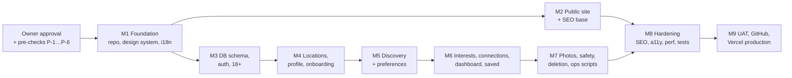

# 11 — Development Roadmap

| Field | Value |
|---|---|
| Product | DUJON (দুজন) |
| Version | 1.0 (draft) |
| Date | 20 November 2026 |
| Status | Awaiting owner approval — **implementation has not started** |

Effort figures are rough estimates for **one developer working with Claude Code**, in working days. They are planning aids, not commitments; re-estimate after Milestone 1.

---

## 1. Stages

| Stage | Content | Status |
|---|---|---|
| 0 Discovery | Brief read, assumptions and open questions identified | Done (this pack) |
| 1 Product documents | 00–03, scope checklist, risks | Done — awaiting review |
| 2 UX/UI planning | 04, 05 | Done — awaiting review |
| 3 Technical planning | 06–12, RTM | Done — awaiting review |
| 4 **Owner review gate** | Owner approves docs and answers open decisions (doc 13) | **Pending** |
| 5 Implementation | Milestones below, one module at a time | Not started |

## 2. Pre-implementation checks (before Milestone 1)

These can change the architecture, so they come first:

| # | Check | Output | Blocks |
|---|---|---|---|
| P-1 | MySQL server facts: version (must be MySQL 8.0.16+), remote TLS access allowed, `max_connections` / `max_user_connections`, server location, backup facility | Filled table in doc 12 §3 | Hosting decision OD-014 |
| P-2 | Connectivity test from a Vercel function to the DB (latency, TLS) | Measured round-trip ms | OD-014 |
| P-3 | Legal question L-02 (data location) | Lawyer's answer | Hosting/storage choice |
| P-4 | Location dataset licence and thana coverage | `MANIFEST.md` | M4 |
| P-5 | SMTP credentials and SPF/DKIM/DMARC on sending domain | Working test email | M3 |
| P-6 | Domain chosen (naming clearance) | Domain for canonical URLs | M8 |

## 3. Milestones and module sequence

| Milestone | Brief sequence items | Deliverables | Depends on | Est. days |
|---|---|---|---|---|
| **M1 Foundation** | 1, 2, 3 | Next.js + TS strict + Tailwind + lint/format; CI (lint, type, test, build); design tokens; core UI components (Button, fields, Select, Dialog, Toast, Tabs, Accordion); next-intl routing (`/` bn, `/en`), switcher, message files skeleton, i18n check script; security headers | Owner approval | 5–6 |
| **M2 Public site** | 4 | Header/footer, Home (with placeholder search UI), How it works, Safety, FAQ, Contact page (form wired in M3 once DB exists), legal page shells, 404; metadata, sitemap, robots, OG image | M1 | 4–5 |
| **M3 Data + Auth** | 5, 6 | Drizzle schema + migrations for all MVP tables; DB client with pooling; rate limiter; mailer + templates; register/login/logout/reset/verify; sessions; 18+ rule; middleware gating; contact form backend | M1, P-1, P-5 | 6–7 |
| **M4 Profiles** | 7, 8 | Location dataset + seed + API; LocationCascade; onboarding steps 1–2 and 4 (photo step stubbed); profile edit page; publish/hide; text guard; preview | M3, P-4 | 6–7 |
| **M5 Discovery** | 9 | `isDiscoverable` policy; search service + page + API; filters, URL state, pagination, empty/cold-start states; preferences page; profile detail page | M4 | 4–5 |
| **M6 Interactions** | 10, 11 | Interest service/state machine; confirm dialog; interests page tabs; connections + contact reveal; email notifications; dashboard overview; saved profiles | M5 | 5–6 |
| **M7 Trust & safety** | 12, 13 | R2 storage; photo upload pipeline; visibility; photo route; onboarding step 3; block/unblock; report; ops scripts; settings page; account deletion; purge cron | M6 | 6–7 |
| **M8 Hardening** | 14, 15 | Full TC suite green; axe and keyboard pass; Lighthouse budgets; 50k load test on staging; security review (doc 09 §13); copy review by Bangla editor | M7 | 5–6 |
| **M9 Release** | 16, 17, 18 | Local UAT with owner (doc 10 §4); clean Git history; Vercel production project + env; production migrations; DNS/HTTPS; backups; monitoring; launch checklist | M8, P-2, P-3, P-6 | 3–4 |
| | | | **Total (indicative)** | **≈ 44–53 days** |

Ordering note vs the brief: the brief lists "Public layout and homepage" (4) before "MySQL schema" (5). This is kept, but the **contact form backend** moves to M3 because it needs the database. "Photo upload" (12) stays after interests to keep the core loop testable earlier; the onboarding photo step is stubbed until M7.

## 4. Definition of Done (per module)

A module is done only when:
1. All its FRs' acceptance criteria are met (RTM rows checked).
2. Unit/integration/E2E tests for its TCs exist and pass in CI.
3. Both locales complete; i18n check passes; Bangla copy reviewed.
4. Accessibility: axe clean; keyboard path works.
5. No business logic in UI components; services documented with JSDoc.
6. Security: authorisation via policies; inputs validated with shared Zod schemas.
7. Docs updated if behaviour differs (and change approved in doc 13).
8. Demonstrated to owner on a preview deployment (or locally) and accepted.

## 5. Risks and contingency (delivery)

| Risk | Contingency |
|---|---|
| Owner's MySQL unsuitable for Vercel (P-1/P-2) | Switch to deployment option B (VPS) or C (managed MySQL) — doc 06 §8; ~2 days extra |
| Lawyer requires in-country data storage (P-3) | Use BD-hosted MySQL + BD/self-hosted S3-compatible storage (e.g. MinIO on owner server) and option B hosting; ~3–5 days extra |
| Location data gaps (thanas) | Ship districts + upazilas first, add thanas as data patch; UI already supports `type='thana'` |
| Email deliverability poor | Switch SMTP env vars to a transactional provider |
| Schedule pressure | Defer **Should** items in this order: FR-SAVE-*, FR-PROF-009, FR-DISC-013, FR-I18N-005, FR-INT-009, FR-ACC-003/006, FR-SEO-007 (owner decides) |
| Scope additions | Logged in doc 13; estimated; approved before work |

## 6. Post-MVP candidates (not planned, for discussion)
Identity verification · admin panel · religion and additional optional fields (after user research) · in-app messaging · native/mobile app via the existing API · paid plans · testimonials with consent workflow · diaspora support.
